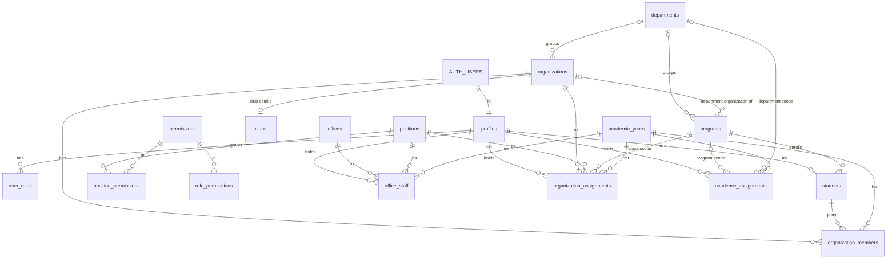
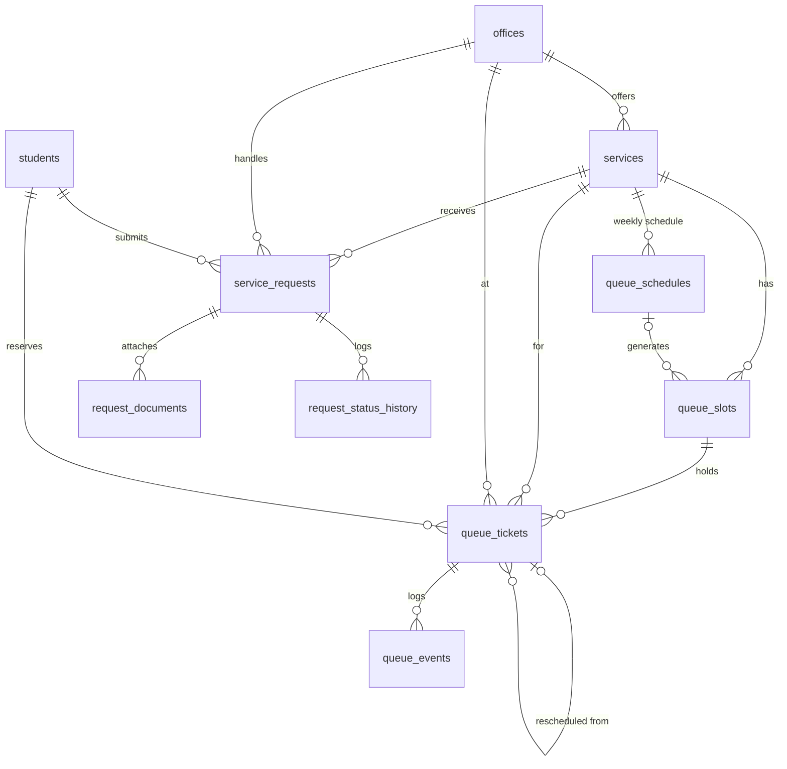
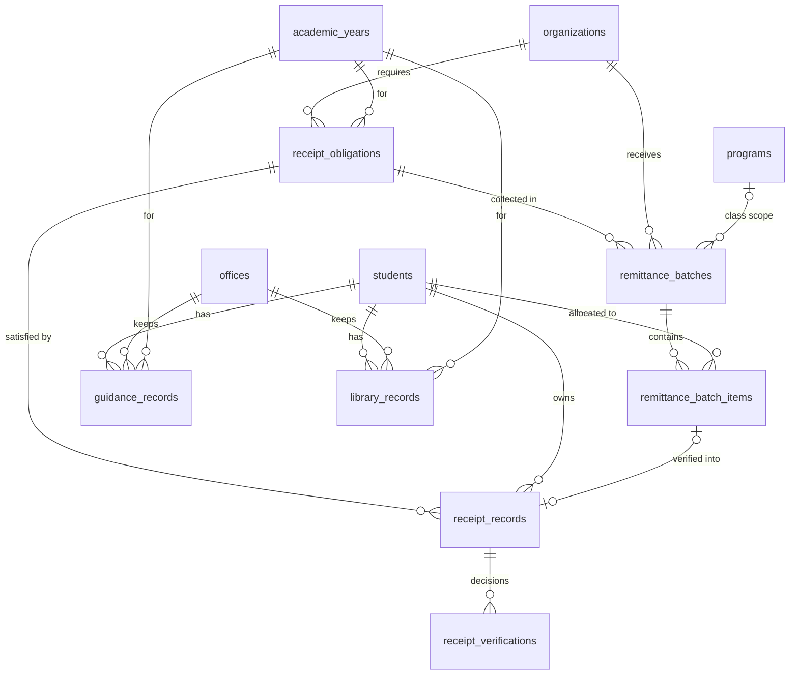
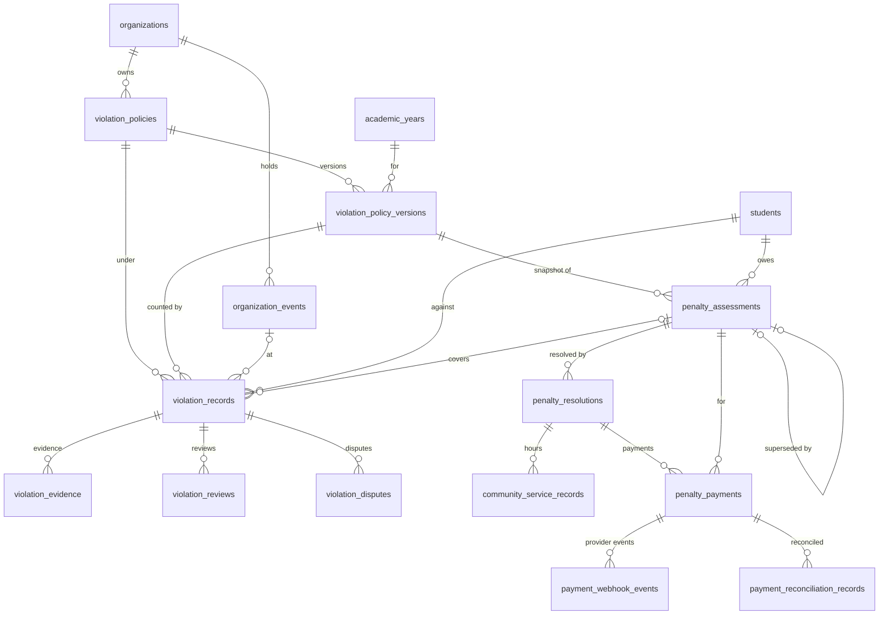
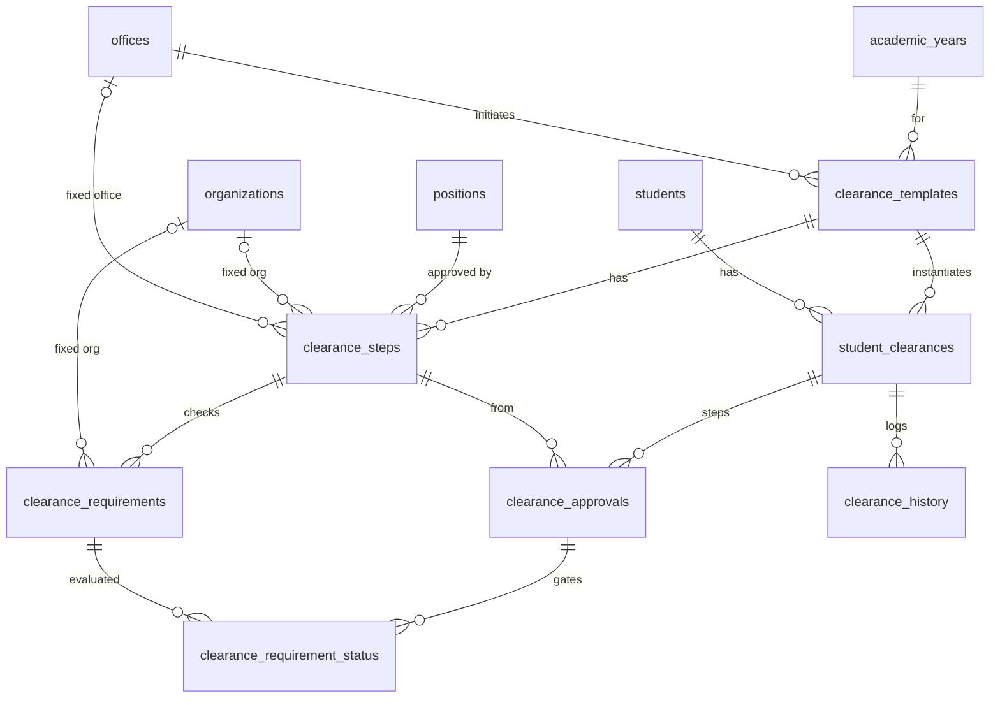
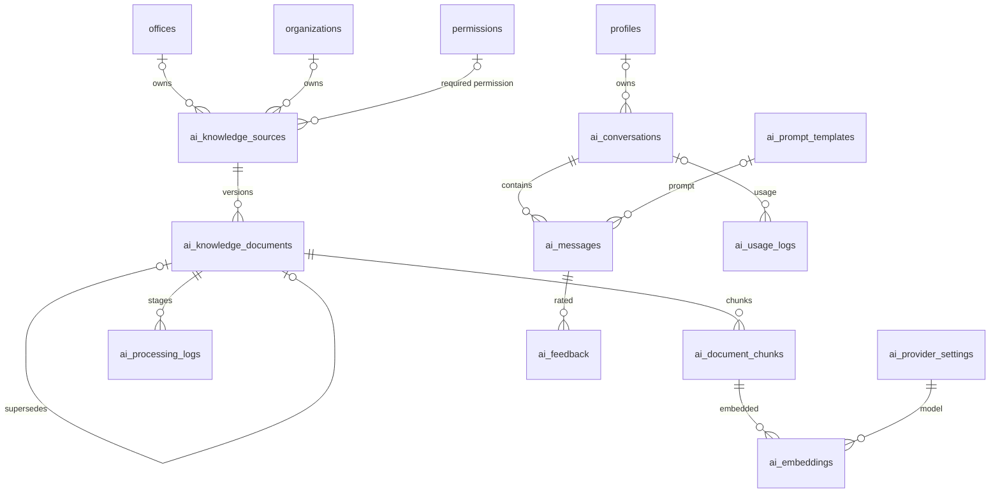
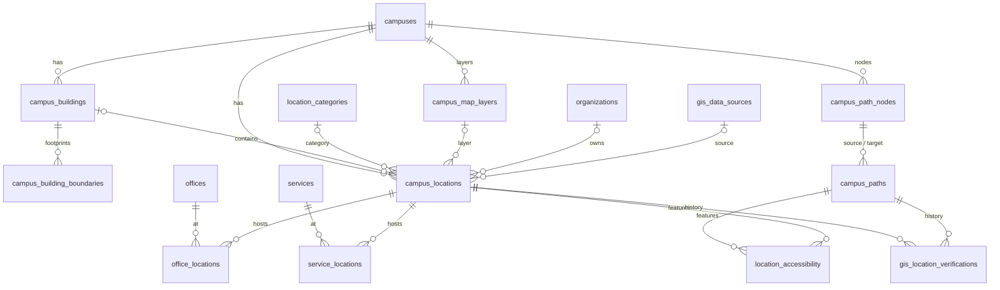
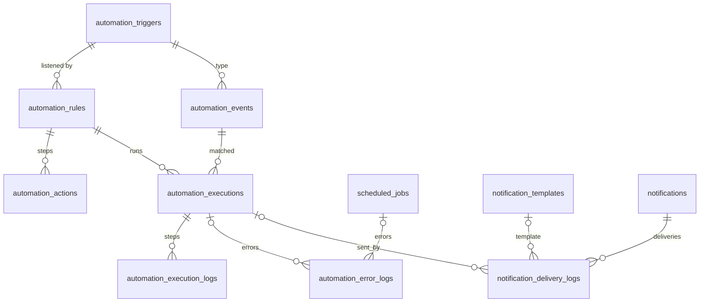

# CampusServe database schema

CampusServe runs on Supabase PostgreSQL (project **CampusServe**, ref `iafcgxwckoelhmfaddzp`, region `ap-southeast-1`).
This document explains the design. The column-by-column reference, with every constraint, index and
RLS policy, is generated from the live schema in [DATABASE_TABLE_REFERENCE.md](DATABASE_TABLE_REFERENCE.md).

| | |
|---|---|
| Tables | 89 in schema `public`, all with Row Level Security enabled |
| Workflow functions | 70 in `public`, called through the Supabase Data API as RPC |
| Internal helpers and triggers | 61 in `private` (not exposed through the Data API) |
| RLS policies | 90 |
| Triggers | 119 (audit, `updated_at`, integrity guards, automation event capture) |
| Extensions | pgvector 0.8.2, PostGIS 3.3.7, pgRouting 3.4.1, pg_trgm 1.6 (schema `extensions`), pg_cron 1.6.4 |
| Migrations | 16, in `Database/migrations/` (see [CHANGELOG.md](CHANGELOG.md)) |

## Design rules

1. **Reads go through RLS, writes go through functions.** Signed-in users have `SELECT` only. Every change
   (reserve a slot, verify a receipt, approve a clearance step, ...) is a `SECURITY DEFINER` function that
   identifies the caller with `auth.uid()`, checks their assignment, applies the business rule and records
   history. The one direct write is marking your own notification as read. The anonymous role has no access.
2. **Authority comes from assignments, not hardcoded roles.** Five system roles describe the account
   (student, office_staff, administrator, cashier, department_head). Operational authority (SSG Governor,
   Treasurer, Guidance Staff, SAS Head, Program Head, ...) is a *position* held in one organization, office,
   program or department for one academic year. Positions and their permissions are rows in tables.
3. **Configuration over hardcoding.** Clearance steps and order, program→organization mappings, violation
   policies, receipt applicability, library slip prerequisites and enabled payment providers are data.
   Anything the specification does not confirm is stored as unconfirmed and documented, never invented.
4. **History is immutable.** Policy versions cannot change once active; assessments snapshot the policy
   version they used; clearances snapshot their template; the audit log is append-only.
5. **No self-service approvals.** CHECK constraints stop a student from being the verifier of their own
   receipt, allocation, guidance/library record, violation review, dispute decision, penalty, community
   service or payment — even for direct writes by the service role.

## Tables by domain

The tables requested for Phase 1 are all present under the requested names. Seven supporting tables were
added where the design needed them (marked ➕).

### Core and identity

| Table | Purpose |
|---|---|
| `profiles` | One row per Supabase Auth user (created by a trigger on `auth.users`). |
| `user_roles` | System roles of a user (several allowed). New users get `student`; roles are never taken from sign-up metadata. |
| `students` | Student number, program, year level, section, enrollment status. |
| `departments` | Academic departments. |
| `programs` | Programs and their department-organization mapping (`organization_mapping_status` confirmed / unconfirmed). |
| `academic_years` | Academic years; exactly one may be current. |
| `offices` | SAS, Guidance, Library, Registrar, Cashier, ... |
| `office_staff` | Office assignments (position + office + academic year). |
| `organizations` | SSG, department organizations, clubs. |
| `clubs` | Club-specific details (one row per club organization). |
| `organization_members` | Club / organization membership per academic year. |
| `organization_assignments` | Organization assignments (Governor, Mayor, Treasurer, Class Officer with program/section scope, ...). |
| ➕ `academic_assignments` | Program Head and Department Head assignments. |
| ➕ `positions` | Position catalog with its scope (organization / office / academic). |
| ➕ `permissions` | Permission catalog. |
| ➕ `position_permissions` | What each position may do. |
| ➕ `role_permissions` | Campus-wide permissions of system roles (administrator, cashier). |

### Services and queue

| Table | Purpose |
|---|---|
| `services` | Office services with queue rules (max active tickets, cancellation cutoff, rescheduling). |
| `service_requests` | Document / service requests and their status. |
| `request_documents` | Index of uploaded files (private `request-documents` bucket). |
| `request_status_history` | Every request status change (trigger). |
| `queue_schedules` | Weekly schedule templates used to generate slots. |
| `queue_slots` | Bookable time slots with `capacity`, `reserved_count`, `last_queue_number`. |
| `queue_tickets` | Reservations (queue number, status). |
| `queue_events` | Every ticket status change. |

### Receipts and remittance

| Table | Purpose |
|---|---|
| `receipt_obligations` | What a student must pay an organization in an academic year, and who it applies to. |
| `receipt_records` | Receipts. Only `verified` receipts satisfy an obligation. |
| `receipt_verifications` | Every verify / reject / void decision. |
| `remittance_batches` | Batch collected by a class officer: declared, itemized and received totals. |
| `remittance_batch_items` | One student's allocation in a batch; verified individually. |

### Guidance and library

| Table | Purpose |
|---|---|
| `guidance_records` | Teacher-evaluation status and guidance clearance slip, per student per year. |
| `library_records` | Library ID validation, library receipt and library clearance slip, per student per year. |

### Clearance

| Table | Purpose |
|---|---|
| `clearance_templates` | Versioned clearance process per academic year, with the initiating office. |
| `clearance_steps` | Approval steps: position, how its scope is resolved, sequence (equal sequence = parallel). |
| `clearance_requirements` | Gates checked at a step (receipts, slips, library items, unresolved penalties). |
| `student_clearances` | A student's clearance, with a snapshot of the template. |
| `clearance_approvals` | One row per step for that student, with the resolved approver scope. |
| `clearance_requirement_status` | Latest evaluation of each requirement, with details. |
| `clearance_history` | Initiation, evaluations, approvals, returns, completion, cancellation. |

### Violations and penalties

| Table | Purpose |
|---|---|
| `violation_policies` | An organization's policy identity (e.g. SSG event violation, PADC bottle policy). |
| `violation_policy_versions` | Immutable rule versions: calculation type, rates, allowed resolutions, `penalty_confirmed`. |
| ➕ `organization_events` | Events, so quantity-based tallies (PADC bottles) are per event. |
| `violation_records` | Reported violations, with the policy version and computed count. |
| ➕ `violation_evidence` | Index of evidence files (private `violation-evidence` bucket). |
| `violation_reviews` | Verify / reject and dispute decisions. |
| `violation_disputes` | Student disputes. |
| `penalty_assessments` | Penalty for a set of verified violations, with a policy snapshot. |
| `penalty_resolutions` | The resolution the student chose (community service or payment). |
| `community_service_records` | Hours rendered, verified by the responsible organization. |
| `penalty_payments` | Digital payment records (GCash / Maya / LANDBANK), idempotency key, provider IDs, status. |

### Payment infrastructure and system

| Table | Purpose |
|---|---|
| `payment_webhook_events` | Every provider webhook, unique per (provider, provider_event_id). |
| `payment_reconciliation_records` | Reconciliation of a payment against provider records. |
| `notifications` | In-app notifications (Realtime enabled). |
| `audit_logs` | Append-only audit log. |
| `system_settings` | Non-secret configuration (time zone, enabled providers, library prerequisites). |

### AI (migration 012) — see [AI_MODULE.md](AI_MODULE.md)

| Table | Purpose |
|---|---|
| `ai_provider_settings` | provider / model / limits; `secret_ref` is the NAME of a backend secret, never the key |
| `ai_prompt_templates` | versioned system prompts (one active per code) |
| `ai_knowledge_sources` | knowledge sources: owner, visibility (`public`/`authenticated`/`permission`), official status (approved by a second person) |
| `ai_knowledge_documents` | versioned documents with processing status; one current version per lineage |
| `ai_document_chunks` | text chunks with a generated `tsvector` and trigram index |
| `ai_embeddings` | pgvector embeddings, dimension recorded per row |
| `ai_conversations`, `ai_messages`, `ai_feedback` | private conversations, messages with citations, ratings |
| `ai_processing_logs`, `ai_usage_logs` | pipeline stages; usage, latency, errors (no content) |

### GIS (migration 013) — see [GIS_MODULE.md](GIS_MODULE.md)

| Table | Purpose |
|---|---|
| `campuses` | OMSU Mamburao Campus (no geometry seeded) |
| `gis_data_sources`, `location_categories`, `campus_map_layers` | provenance, categories, layers with visibility |
| `campus_buildings`, `campus_building_boundaries` | buildings and versioned footprints |
| `campus_locations`, `office_locations`, `service_locations` | points of interest linked to offices and services |
| ➕ `campus_path_nodes`, `campus_paths` | walking network (pgRouting); routing uses verified paths only |
| `location_accessibility` | accessibility features |
| `gis_location_verifications` | append-only verification history |

### Automation (migration 014) — see [AUTOMATION_MODULE.md](AUTOMATION_MODULE.md)

| Table | Purpose |
|---|---|
| `automation_triggers` | catalog of supported events |
| `automation_rules`, `automation_actions` | rules (conditions, scope) and their ordered actions (closed list, no decisions) |
| ➕ `automation_events` | idempotent event outbox |
| `automation_executions`, `automation_execution_logs`, `automation_error_logs` | queue with retries / dead-letter, step logs, errors |
| `scheduled_jobs` | named jobs synced to pg_cron when enabled |
| `notification_templates`, `notification_delivery_logs` | versioned templates; delivery per notification and channel |

Additive columns on existing tables (migration 015): `services.target_processing_days`,
`service_requests.due_at`, `service_requests.ai_suggested_category / ai_suggestion_confidence / ai_suggested_at`,
`student_clearances.due_date` — all nullable, unconfirmed values left empty.

## Relationships (ERD)

Actor columns (`recorded_by`, `verified_by`, `assigned_by`, `acted_by`, ...) all reference `profiles` and
are left out of the diagrams to keep them readable. Every relationship below is a real foreign key.

### Identity, organizations and assignments

### Services and queue

### Receipts, remittance, guidance and library

### Violations, penalties and payments

### Clearance

### AI

### GIS

### Automation

## Key integrity rules enforced in the database

| Rule | How |
|---|---|
| No queue overbooking | `reserve_queue_slot` locks the slot row (`FOR UPDATE`); `CHECK (reserved_count <= capacity)`; tested with 10 concurrent sessions. |
| No duplicate reservations | Partial unique index on (`slot_id`, `student_id`) for live tickets; per-service active-ticket limit; unique queue number per slot. |
| A batch total never pays anyone | Receipts are created only by `verify_remittance_batch_item`, one allocation at a time, and only when the allocation equals the obligation amount. |
| One live receipt per obligation and student | Partial unique index on `receipt_records`. |
| Guidance slip needs teacher evaluations | `CHECK` constraint on `guidance_records`. |
| Library slip prerequisites | Trigger reading `system_settings.library.slip_prerequisites`. |
| Only verified violations count | Assessments and clearance checks use `status = 'verified'` only. |
| PADC floor division, per event | `private.compute_violation_count`; one live tally per student per event (partial unique index). |
| Unconfirmed penalties cannot be assessed | `penalty_confirmed` must be true; otherwise `PENALTY_NOT_CONFIGURED`. |
| Historical policies preserved | Trigger makes non-draft policy versions immutable; assessments keep `policy_snapshot` and cannot change amounts. |
| Payments settle only through the provider | Only the service-role webhook function can set `paid`; verification requires `paid`; webhooks idempotent on (provider, event id). |
| Clearance gate | `approve_clearance_step` re-evaluates requirements, checks the held position and scope, earlier steps and self-approval. |
| Templates locked once active | Trigger blocks edits to steps / requirements of active or retired templates. |

## Database functions

Workflow functions (public, callable with the user's JWT; each checks the caller):

| Area | Functions |
|---|---|
| Queue | `reserve_queue_slot`, `cancel_queue_ticket`, `reschedule_queue_ticket`, `update_queue_ticket_status`, `call_next_queue_ticket`, `generate_queue_slots` |
| Requests | `submit_service_request`, `update_service_request_status` |
| Receipts | `record_individual_receipt`, `verify_receipt_record`, `create_remittance_batch`, `upsert_remittance_batch_item`, `remove_remittance_batch_item`, `submit_remittance_batch`, `begin_remittance_batch_review`, `verify_remittance_batch_item`, `finish_remittance_batch_review` |
| Guidance / Library | `confirm_teacher_evaluations`, `issue_guidance_slip`, `validate_library_id`, `verify_library_receipt`, `issue_library_slip` |
| Violations | `calculate_violation_count`, `calculate_penalty`, `report_violation`, `review_violation`, `file_violation_dispute`, `decide_violation_dispute` |
| Penalties / payments | `assess_penalty`, `select_penalty_resolution`, `submit_community_service`, `verify_community_service`, `create_penalty_payment`, `verify_penalty_payment`, `record_payment_reconciliation` |
| Clearance | `initiate_student_clearance`, `evaluate_student_clearance`, `approve_clearance_step`, `return_clearance_step`, `cancel_student_clearance` |
| AI | `search_knowledge`, `ai_register_knowledge_source`, `ai_approve_official_source`, `ai_register_document`, `ai_submit_feedback`, `record_request_ai_suggestion` |
| GIS | `gis_save_location`, `gis_link_service_location`, `gis_save_building`, `gis_set_building_boundary`, `gis_save_path`, `gis_set_campus_geometry`, `gis_verify_feature`, `gis_import_geojson`, `gis_map_features`, `gis_search_locations`, `gis_find_route`, `gis_nearest_service_locations`, `gis_activity_by_location` |
| Automation (configuration) | `automation_save_rule`, `automation_set_rule_enabled`, `automation_update_scheduled_job`, `automation_save_notification_template`, `automation_run_scheduled_job` |
| Service role only | `attach_payment_checkout`, `process_payment_webhook`, `ai_record_processing_stage`, `automation_run_due`, `automation_claim_backend_executions`, `automation_complete_execution` |

Errors are raised with a stable machine-readable code as the message (for example `SLOT_FULL`,
`FORBIDDEN`, `CLEARANCE_REQUIREMENTS_NOT_MET`) and a human explanation as the hint. Permission
failures use SQLSTATE `42501`; business-rule failures use `P0001`.

Private helpers: authorization (`has_org_permission`, `has_office_permission`, `has_program_permission`,
`has_global_permission`, `holds_position`, `can_view_student`, `can_view_clearance`, `require_actor`, ...),
calculation (`compute_violation_count`), evaluation (`evaluate_requirement`, `refresh_clearance_requirements`,
`obligation_applies`), and trigger functions (audit, `updated_at`, immutability and integrity guards).

## Storage and Realtime

- Private buckets: `violation-evidence` (5 MB), `request-documents` (10 MB), `community-service-proofs` (5 MB),
  JPEG / PNG / PDF only; `ai-knowledge` (20 MB; PDF, DOCX, TXT, Markdown, HTML); `gis-imports` (10 MB; GeoJSON). No `storage.objects` policies exist, so only the backend (service role) can read or
  write files; it must check access and issue short-lived signed URLs.
- Realtime publication: `queue_tickets`, `queue_slots`, `notifications` (RLS applies to subscribers).
- pg_cron: job `campusserve_automation_executor` runs `automation_run_due(100)` every minute; scheduled jobs are
  added only when an administrator enables them.
