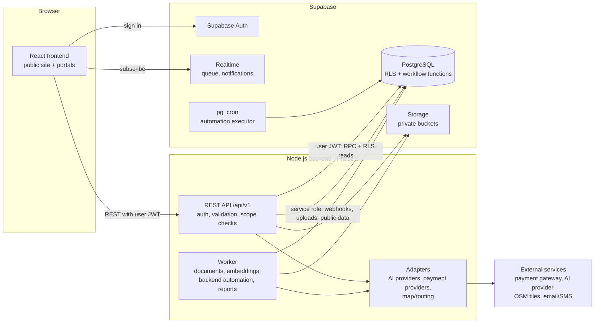

# System architecture

CampusServe for Occidental Mindoro State University – Mamburao Campus.

| Layer | Technology | Status |
|---|---|---|
| Database | Supabase PostgreSQL 17 (project `iafcgxwckoelhmfaddzp`), RLS, Storage, Realtime, pgvector, PostGIS, pgRouting, pg_trgm, pg_cron | **Built and verified (Phase 1)** |
| Backend | Node.js, Express, TypeScript, Zod; REST `/api/v1` | Phase 2 — not started |
| Frontend | React, Vite, TypeScript, Tailwind CSS, shadcn/ui, Radix UI, React Router, React Hook Form, Zod, Framer Motion, Chart.js, Leaflet | Phase 2 — not started |
| Hosting | Vercel (frontend), Render or similar (backend + worker), Supabase (database) | Phase 4 |
| External | GCash / Maya / LANDBANK (authorized gateway), AI provider, map tiles, email/SMS | **None connected** |

## Components

## Trust boundaries

1. **Browser** holds only the anon (publishable) key and the user's session. It never sees the service-role
   key, provider keys or database credentials.
2. **Backend** verifies the user's Supabase JWT on every request and calls workflow functions *with that
   JWT*, so the database applies the same authorization a direct call would. It uses the service role only
   for: payment webhooks (`process_payment_webhook`, `attach_payment_checkout`), storage uploads and signed
   URLs, document-processing and automation workers, and serving public (signed-out) map and assistant data
   with `p_public_only = true`.
3. **Database** is the final authority: RLS on all 89 tables, `SECURITY DEFINER` workflow functions with
   `search_path` pinned, CHECK constraints against self-verification, append-only audit and history.
   `anon` has no table or function access.

## Where business rules live

| Rule | Enforced in |
|---|---|
| Who may read what | RLS policies + `private.*` permission helpers |
| Workflow transitions, scopes, self-verification | workflow functions + CHECK constraints |
| Queue capacity and duplicates | row lock + CHECK + partial unique index |
| Batch remittance per-student verification | `verify_remittance_batch_item` |
| Penalty calculation and history | policy versions (immutable) + assessment snapshot |
| Payment settlement | service-role webhook function + idempotent event table |
| Clearance gate | `approve_clearance_step` (live re-evaluation) |
| Knowledge permissions | `search_knowledge` + `can_access_knowledge_source` |
| GIS verification and routing | `gis_verify_feature`, `gis_find_route` (verified data only) |
| Automation limits | closed action list (CHECK), isolated event capture |

The backend will add input validation (Zod), rate limiting, consistent responses and error mapping
(function error codes → HTTP status), but it does not replace these database rules.

## Data flows

- **Queue:** student → `reserve_queue_slot` → ticket; staff → `update_queue_ticket_status` /
  `call_next_queue_ticket`; Realtime pushes `queue_tickets` / `queue_slots` changes.
- **Clearance:** SAS → `initiate_student_clearance`; offices/organizations complete receipts, guidance,
  library; approvers → `approve_clearance_step` in template order; automation may re-evaluate requirements.
- **Payments:** student → `create_penalty_payment` → backend adapter → provider checkout → provider webhook →
  backend signature check → `process_payment_webhook` → organization verifies. No provider is enabled.
- **AI (Phase 2):** user question → backend → `search_knowledge` (with the user's JWT) → provider → answer with
  citations stored in `ai_messages`; usage in `ai_usage_logs`.
- **GIS:** administrators enter and verify features; map, search, routing and analytics read through the
  GIS functions.

## Environments

One Supabase project today (development data: sample accounts without passwords). A separate production
project, or removal of the development seed (`Database/seed/900_remove_dev_seed.sql`), is required before
real use — decided in Phase 4.

## Backend request model (Phase 2)

1. `Authorization: Bearer` token verified by the backend (JWKS or HS256; audience, issuer, role, expiry).
2. One database transaction per request: `set_config('request.jwt.claims', ...)` + `set local role authenticated`.
   RLS and the workflow functions' own checks decide what the caller may read and do.
3. Writes go through workflow functions (`public.*`, called with named `p_` arguments). Where no function
   exists (admin configuration, file metadata), the backend first checks the permission inside the same
   transaction, then switches to `service_role` for that write; the JWT subject stays the caller, so the audit
   log records them.
4. Webhooks, public read-only endpoints and the worker use the service role. Public endpoints return only
   active, public, verified data.
5. Database errors map to HTTP: business codes from `private.fail` become 404/409/422 with the database's
   message; permission errors become 403; other errors become a generic 500 (details only in server logs).
